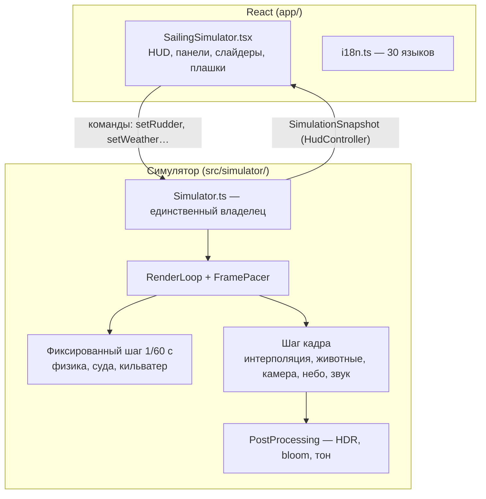

# Sailing Simulator Pro

Браузерный симулятор парусного катамарана в тропическом архипелаге: React-интерфейс поверх собственного движка на Three.js, физика яхты по силам, океан из общего спектра волн для GPU и CPU, погода от штиля до урагана, суда, дикие животные и процедурный звук. Работает на десктопе и телефоне, на 30 языках.

> Этот файл — обзор проекта для человека: что это, как устроено и где что лежит. Обязательные инварианты, порядок кадра, чек-листы изменений и критерии готовности для разработчиков и агентов описаны в [AGENTS.md](./AGENTS.md); при расхождении верен он. Лицензии моделей: [public/models/README.md](./public/models/README.md).

---

## Содержание

1. [Суть проекта](#1-суть-проекта)
2. [Быстрый старт](#2-быстрый-старт)
3. [Управление](#3-управление)
4. [Технологический стек](#4-технологический-стек)
5. [Архитектура](#5-архитектура)
6. [Подсистемы](#6-подсистемы)
7. [Карта файлов](#7-карта-файлов)
8. [Соглашения](#8-соглашения)
9. [Производительность и качество](#9-производительность-и-качество)
10. [Тесты](#10-тесты)
11. [Сборка и развёртывание](#11-сборка-и-развёртывание)
12. [Где что менять](#12-где-что-менять)
13. [Известные ограничения](#13-известные-ограничения)

---

## 1. Суть проекта

Цель — убедительная и сразу играбельная морская сцена, а не инженерный расчёт яхты. Игрок с первого взгляда должен видеть, что:

- катамаран стоит **на тех же волнах**, что нарисованы (физика, кильватер, животные и камера читают одну поверхность);
- двигатель, газ, руль, паруса, курс и вымпельный ветер — разные вещи;
- два корпуса оставляют два следа, винт — отдельную струю;
- день, сумерки и ночь — согласованные состояния освещения, а не цветовые фильтры;
- острова — это архипелаг из нескольких десятков островов с мелководьем, прибоем и берегом, о который нельзя разбиться;
- большие суда проходят вдали или стоят на якоре, к ним можно подойти, их кильватер качает яхту;
- животные — лицензированные риггованные модели, которые плывут вперёд с инерцией и пересекают воду там, где она реально нарисована.

Главное ограничение — **стабильная частота кадров на телефонах среднего уровня**. Детализация выбирается по пользе для восприятия, а не по числу полигонов.

### Что есть в сцене

| Область | Кратко |
| --- | --- |
| Океан | 8 волн Герстнера (6 пассатных + 2 штормовые зыби) общие для GPU и CPU; аналитические нормали по пикселю, капиллярная рябь, отражение неба по Френелю, планарное зеркало, солнечная/лунная дорожка (GGX), барашки, цвет по батиметрии, прибой на каждом пляже |
| Яхта | Детальная GLB-модель катамарана; гик на шарнире с поворотом и ударом при фордевинде; процедурные винты, рули, штурвальный пост с картплоттером и приборами |
| Физика | Поляра паруса (мёртвый угол ~35°, максимум на полном курсе), порывистый ветер, валы двигателей с инерцией, кили как крылья, дрейф, крен на подветренный борт, вертикальная качка, мели; автоотворот от берегов и бортов судов |
| Кильватер | Две кормовые колеи, струя винта, расходящиеся волны Кельвина, брызги; рисуется в текстуру и превращается шейдером океана в воду, а не в декали |
| Погода | 7 типов (ясно → ураган), авто-планировщик, дождь, молнии с громом с задержкой по расстоянию, автосмена времени суток |
| Небо | Аналитическое небо и облака, солнце с ореолом, луна с кратерами, звёзды; IBL-освещение из того же неба |
| Суда | Контейнеровоз, танкер, балкер, автовоз, лайнер — процедурные корпуса, огни ночью, кильватер Кельвина, гудки, звук дизеля |
| Животные | Стая дельфинов (эскорт, прыжки на скорости), акула, кит (выныривание, удары хвостом), дальний кит с выпрыгиванием, рифовые рыбы (бойды), чайки |
| Звук | Полностью синтезированный Web Audio: дизель, волны, ветер, корпус, всплески, чайки, гром, суда |
| Интерфейс | 4 камеры, фото-режим, 30 языков с RTL, PWA, адаптивная раскладка от 320 px до 4K |

---

## 2. Быстрый старт

Требуется Node **22.13+**.

```bash
npm ci
npm run dev          # Vite + Vinext, URL выведется в консоль
```

| Команда | Что делает |
| --- | --- |
| `npm test` | Юнит-тесты (`node --test` + `tsx`, `tests/unit/*.test.ts`) |
| `npm run typecheck` | `tsc --noEmit` в окружении `scripts/sites-env.sh` |
| `npm run lint` | ESLint |
| `npm run build` | Продакшен-сборка через `scripts/build-verified.sh` |
| `npm run test:rendered` | Smoke-тест собранного маршрута |
| `npm start` | Запуск собранного приложения (`vinext start`) |

Отдельного HTML-файла симулятора нет: React-приложение динамически импортирует браузерный модуль `src/simulator`.

---

## 3. Управление

| Действие | Сенсор / мышь | Клавиатура |
| --- | --- | --- |
| Руль | Горизонтальный слайдер + кнопка «Центр» | `A` / `D`, `Space` — центр |
| Газ | Вертикальный слайдер: назад — нейтраль — вперёд | `W` / `S` |
| Двигатель | Большой переключатель (запуск из нейтрали включает «малый вперёд») | — |
| Камера | Свайп — обзор, щипок / колесо — зум, двойной тап — центр | — |
| Сброс | Кнопка «Сбросить сцену» | `R` |
| Фото-режим | Кнопка; выход — тап по сцене, `Esc` или `Tab` | `Esc` |

Панель настроек (свёрнута по умолчанию): день/ночь, автосмена времени суток, двигатель, звук, звук двигателя, камера (погоня / штурвал / орбита / дрон), погода (авто/ручная + 7 типов), натяжение паруса, качество, язык. Каждый переключатель на ~2,4 с показывает плашку с названием действия («Время дня: Ночь», «Погода: Авто»).

Звук в браузере включается только жестом пользователя: при готовой сцене появляется капсула «Нажмите для звука», которая затем «рассыпается» в кнопку звука в левом верхнем углу.

---

## 4. Технологический стек

| Слой | Реализация |
| --- | --- |
| UI | React 19.2, клиентский компонент `app/components/SailingSimulator.tsx` |
| Каркас | Соглашения Next 16, сборка Vinext 0.0.50 + Vite 8 |
| Язык | TypeScript 5.9, strict |
| 3D | Three.js 0.180 (WebGL2), только локальные модули и ассеты |
| Постобработка | `EffectComposer`: half-float HDR-цель с MSAA, UnrealBloom, финальный проход (ACES, виньетка, зерно) |
| Звук | Web Audio API, полностью процедурный |
| Хостинг | Cloudflare Worker (`worker/index.ts`) через ChatGPT Sites (`.openai/hosting.json`) |
| Тесты | Node test runner + `tsx` |
| БД | Drizzle + D1 в шаблоне, симулятором не используется |

Всё самодостаточно: Three.js и код собираются в бандл, модели — локальные GLB в `public/models`.

---

## 5. Архитектура

### 5.1 Слои



- **React владеет только интерфейсом.** Он вызывает публичные методы `Simulator` (`setRudder`, `setThrottle`, `setSailTrim`, `setLightingMode`, `setAutoTime`, `setWeatherMode`, `setWeather`, `setCameraMode`, `setQuality`, `setSoundEnabled`, `setEngineMuted`, `setEngineRunning`, `reset`, `dispose`) и получает неизменяемые снимки `SimulationSnapshot` с собственной частотой через `HudController`.
- **`Simulator` — единственный владелец** всех подсистем: создаёт, упорядочивает обновления, сохраняет настройки, освобождает ресурсы.
- **Чистая математика отделена от сцены.** Всё численное (волны, погода, поведение животных, планирование судов, автоотворот, молнии, прибой) живёт в чистых модулях `*Math.ts` / `*Behavior.ts` без WebGL и покрыто юнит-тестами; контроллеры только переносят результат на меши, шейдеры и эффекты.
- **У каждого CPU-расчёта поверхности есть GLSL-двойник**, сгенерированный из тех же таблиц (`OceanMath` ↔ `oceanShader`, `SurfMath`, `SurfaceImpacts`, кильватер судов в `ShipMath`), поэтому физика и картинка не расходятся.

### 5.2 Инициализация (`Simulator.init`)

`QualityManager` → загрузка 7 GLB (`AssetManager`) → океан → окружение (небо, свет) → острова и батиметрия → физика яхты и суда → визуал яхты и паруса → пулы кильватера/брызг → животные → камера → ввод → жесты → наблюдение за размером → **компиляция всех шейдеров заранее** (`prewarmShaders`) → запуск цикла → первый снимок.

`AudioSystem` создаётся раньше, в конструкторе, чтобы слушатели жестов существовали ещё во время загрузки (нужно для iOS).

### 5.3 Цикл кадра (`RenderLoop`)

```text
requestAnimationFrame ─▶ FramePacer (≤60 fps, 30 вне фокуса)
  │
  ├─ Фиксированный шаг 1/60 с (аккумулятор, ≤5 догоняющих шагов, кадр ≤50 мс)
  │    1. время и фокус океана        4. физика яхты (силы, плавучесть, берег)
  │    2. ввод клавиатуры/геймпада    5. контакт яхты с корпусами судов
  │    3. шаг судов (их кильватер)    6. кильватер, брызги, капли
  │
  └─ Шаг кадра (alpha = доля между шагами)
       1. униформы океана              7. окружение и IBL-захват
       2. пальмы                       8. освещение брызг, тени пальм
       3. поза яхты: blendPose(alpha)  9. автоматизация звука
          паруса, гик, суда на волне  10. снимок для HUD (троттлинг)
       4. животные и рыбы             11. рендер через PostProcessing
       5. текстура кильватера (~30 Гц)
       6. камера
```

Интерполяция позы (`VesselPhysics.blendPose` / `restorePose`) устраняет дрожание быстрой яхты, когда кадры дисплея и 60-герцевые шаги физики расходятся.

### 5.4 Состояние и сохранение

`SimulatorState` (`state.ts`) хранит руль, газ, парус, камеру, режим освещения, автовремя, погоду, качество, звук, работу и mute двигателя. В `localStorage` (`sailing-simulator-pro-preferences-v2`) сохраняются освещение, камера, качество, звук, mute двигателя, автовремя и режим/тип погоды; работа двигателя и газ — нет. Язык хранится отдельно (`sailing-simulator-language-v2`). На сенсорных устройствах старт всегда с низкого качества.

---

## 6. Подсистемы

### 6.1 Океан — `environment/OceanMath.ts`, `OceanSystem.ts`, `shaders/oceanShader.ts`

- **Сетка 3600 × 3600 м** (`OceanGrid`), сфокусированная на яхте: равномерный центр (~1,25 м на высоком, ~1,7 м на низком), ячейки растут к горизонту. Сетка переставляется целыми ячейками, поэтому не «скользит» по волнам; каждая вершина знает размер ячейки, и шейдер гасит волны, которые сетка не может передать.
- **`OCEAN_WAVES`** — один источник для смещения в GLSL, аналитической нормали, CPU-выборки высоты (`sampleOcean`), 10 точек плавучести, кильватера, контакта животных и «пола» камеры. Две последние волны — штормовая зыбь (118 и 76 м), включаются по `setSeaScale` и затухают над шельфом островов.
- CPU-выборка обращает горизонтальное смещение Герстнера (`surfaceBasePoint`) и возвращает высоту поверхности, **реально нарисованной** над точкой. С параметром `depth` — движение воды на глубине (для крупных животных).
- Шейдер фрагментов: детальный спектр и рябь с переводом неразрешённой энергии в шероховатость; отражение неба (и облаков) по Шлику; планарное зеркало (`OceanReflection`, только в спокойную погоду); GGX-дорожка; цвет от батиметрии ближайших 8 островов; прибой из `SurfMath`; поле кильватера; кольцевые волны от всплесков (`SurfaceImpacts`); кильватер судов; плавный переход в горизонт неба (640–1250 м).
- Океан прозрачный, не пишет глубину, `renderOrder = 2`. Сетку на CPU не деформировать никогда.

### 6.2 Небо, свет, погода — `EnvironmentSystem.ts`, `shaders/skyShader.ts`, `WeatherMath.ts`

- `EnvironmentMath.deriveTimeOfDay` → `EnvironmentPalette.deriveEnvironmentPalette`: **единственное место**, где заданы цвета дня, сумерек и ночи (в линейном цвете сцены).
- Одна функция неба используется трижды: купол, захват для IBL (`PMREMGenerator` → `scene.environment`), отражение в воде. Захват обновляется только при изменении фактора ночи.
- Солнце, луна и звёзды рисуются самим небом (`skyCelestial`), под облаками. Солнечный диск HDR (светится bloom-ом) с потемнением к краю и широким ореолом; у луны процедурные кратеры трёх масштабов (`moonCraters`), «моря» и пятнистость, яркость ниже порога bloom, чтобы рисунок не заливался.
- Погода: `autoWeatherKind(time)` (первые 8 мин всегда ясно, шторм не раньше 15 мин) или выбор игрока; `stepWeather` плавно ведёт `WeatherSample`, который задаёт волнение, ветер, рифление парусов, затемнение, туман, дождь (`RainSystem`, один инстансный вызов) и молнии.
- Молнии (`LightningMath` + `LightningSystem`): удары выводятся из хеша 1,6-секундных слотов (воспроизводимо при любой частоте кадров), ступенчатый лидер + 1–4 обратных разряда, вспышка неба в направлении удара, гром с задержкой `distance / 343 м/с`.
- `UnderwaterLight`: закон Бугера–Ламберта для всего, что ниже локальной поверхности (красный поглощается первым), плюс каустики.

### 6.3 Острова — `IslandMath.ts`, `IslandSystem.ts`, `IslandSurface.ts`, `SurfMath.ts`

- `generateArchipelago` — детерминированный (seed) архипелаг: 3 «домашних» острова у старта и ~30 в радиусе 2,6 км, от рифовых островков до высоких островов с хребтами. Неправильная береговая линия, эллиптичность, двухлепестковые выступы.
- Запросы к берегу (`distanceFromWaterline`, `shoreClearance`, `nearestShore`) идут через сеточный индекс 200 м — точные и быстрые. `waterDepthAt` спадает от реальной линии воды, поэтому физика, животные и цвет воды согласны в том, где мелко.
- Рельеф — `THREE.LOD` из двух мешей; пальмы — 5 вариантов GLB, высаженных по одной и слитых по кластерам в один меш на материал; шейдер песка (зерно, рябь, мокрый песок, накат), карта теней пальм.

### 6.4 Яхта — `vessel/`

| Файл | Роль |
| --- | --- |
| `VesselPhysics.ts` | Силовая модель: ветер (`WindMath`), паруса (`SailAerodynamics`), парусность корпуса, двигатели (тяга ∝ обороты², 15,6 кН вперёд / 9,7 кН назад, ~13 уз), сопротивление, кили-крылья, рули с обдувом от винта, волновой сёрфинг, мели; качка/дифферент/крен как демпфированные осцилляторы к плоскости воды под корпусами; интерполяция позы |
| `ShoreGuard.ts` | Рефлекс рулевого: прогон кромки корпуса по курсу на дистанцию остановки; при опасности берёт руль, выбирает сторону отворота и держит её, сбавляет ход (или даёт задний), травит паруса; возвращает управление на чистой воде. Учитывает **и берег, и борт ближайшего судна** (`hullClearance` ← `nearestHullClearance`) |
| `ShoreContact.ts` | Физический упор у берега: «подушка» + импульс с отскоком и поворотом, яхта не залипает в песке |
| `Vessel.ts` | Нормализация GLB, классификация частей по форме, шарнир гика, слияние статичных частей (`StaticBatching`), ходовые огни |
| `BoomDynamics.ts`, `SailSystem.ts` | Гик на шкоте, удар при фордевинде, деформация паруса от ветра и натяжения |
| `Appendages.ts`, `YachtShading.ts` | Процедурные saildrive-винты и рули; необрастающая краска, ватерлиния, мокрая полоса по реальной волне, нескользящая палуба, швы парусов |
| `HelmStation.ts`, `HelmInstruments.ts` | Штурвальный пост: штурвал крутится с рулём, картплоттер (острова, суда как AIS, яхта «носом вверх»), скорость/глубина/обороты, ветер, компас, рычаг газа — один canvas-атлас, ночная красная палитра |
| `WakeSystem.ts`, `WakeField.ts` | Колеи корпусов, струя винта, брызги, всплески животных разных видов (`entry`, `exit`, `slap`, `breath`, `blow`) из ограниченных пулов; штампы в текстуру ~150 м, которую читает шейдер океана |

Вертикальная качка следует за ускорением воды (`HEAVE_FOLLOW`), а уровень воды берётся через скользящие средние, поэтому мелкая рябь не трясёт яхту на скорости, а многометровая зыбь не запаздывает (проверено тестом в урагане).

### 6.5 Суда — `ships/`

- `ShipMath.ts` (чистый): типы и размеры (`SHIP_SPECS`, 262–334 м), планирование маршрутов (`planLane`: проход в 300–800 м от яхты, чисто от берегов, появление в 1,5–1,95 км), якорная стоянка, руление (обход мелей, уступить дорогу судну справа, не поворачивать к мели), ватерлиния корпуса и контакт, сигналы, кильватер Кельвина (CPU + GLSL, 4 слота).
- `ShipGeometry.ts`: процедурные корпуса (наклонный форштевень, седловатость, транец), надстройки по типу, окраска, ночные огни.
- `ShipSystem.ts`: 3 судна на ходу + 1 на якоре, замена ушедших, один меш на судно, огни точками, лёгкая собственная дымка, контакт с яхтой, гудки и источники звука.

### 6.6 Животные — `wildlife/`

Общие правила: каждый пловец движется **только вперёд** с ограниченным радиусом поворота (`SwimmerDynamics`), глубину держит без перерегулирования, качается на воде той глубины, где находится; поведение — чистые конечные автоматы (`*Behavior.ts`), протестированные на реальном море и батиметрии; контакт с водой — в именованных точках тела с гистерезисом; острова обходятся заранее (`ShoreAvoidance`), суша недостижима.

| Животное | Поведение | Файлы |
| --- | --- | --- |
| Дельфины | Стая: гуляет, сопровождает, катается на носовой волне; прыжки только на скорости ≥ ~3,5 уз, баллистическая дуга, вход головой | `DolphinBehavior`, `DolphinController` |
| Акула | Патруль, осмотр, проход под корпусами, рывок, уход на глубину, иногда плавник над водой | `SharkBehavior`, `SharkController` |
| Кит | Почти всё время на глубине ~10 м, выныривает с фонтанами, удары хвостом по воде (3 сустава на пружинах) | `WhaleBehavior`, `WhaleController` |
| Дальний кит | Редкое выпрыгивание далеко от яхты: разгон, полёт с вращением, огромный всплеск | `WhaleBreach`, `WhaleBreachController` |
| Рифовые рыбы | ~140 инстансов 4 видов, бойды, бегство от корпусов и хищников, LOD | `ReefFishMath`, `ReefFishController` |
| Чайки | Парение, следование за кильватером, бреющий полёт, нырок, посадка, отдых на воде, взлёт с тревожным криком | `GullBehavior`, `GullFlockController` |

### 6.7 Камера и ввод — `camera/`, `input/`

Камеры `chase` (пружинное следование, FOV от скорости), `helm` (глаза рулевого, голова частично компенсирует крен и дифферент), `orbit`, `drone`. Жесты на canvas управляют **только камерой**; руль и газ — React-элементы вне canvas. Камера не опускается под воду. Ближняя плоскость 0,08 м у штурвала и 0,35 м снаружи.

### 6.8 Звук — `audio/AudioSystem.ts`

```text
Master → Compressor → destination
  EngineBus      — дизель (4 цилиндра, 26–86 Гц), детонация, выхлоп, low-pass от оборотов; звук запуска
  EnvironmentBus — волны, ветер (от погоды), свист такелажа, вода у корпуса, гром, 2 судна + гудки
  WildlifeBus    — всплески (панорама и тембр по расстоянию), крики чаек
```

`soundEnabled` (настройка) и `audioReady` (контекст реально играет) — разные состояния. Контекст создаётся и возобновляется только по доверенному жесту; на скрытой странице приостанавливается.

### 6.9 Постобработка — `core/PostProcessing.ts`

Сцена → multisample half-float цель → bloom только для пикселей ярче `BLOOM_THRESHOLD` (1,35) → финальный проход (хроматизм у краёв, насыщенность, виньетка, ACES, sRGB, зерно). Все HDR-значения перед bloom и финалом очищаются от NaN и ограничиваются `HDR_CEILING` (иначе один «битый» пиксель размазывается на весь кадр — мигание или чёрный экран). На низком качестве конвейер выключен, и каждый материал сам делает тональное отображение, поэтому все кастомные шейдеры обязаны заканчиваться `#include <tonemapping_fragment>` и `#include <colorspace_fragment>`.

---

## 7. Карта файлов

```text
app/
  page.tsx, layout.tsx            маршрут, метаданные, PWA
  components/SailingSimulator.tsx мост к симулятору, HUD, панели, плашки, фото-режим
  components/SoundPrompt.tsx      капсула «нажмите для звука» и её анимация
  components/i18n.ts              30 языков, определение языка системы, RTL
  globals.css                     раскладка, брейкпоинты, safe-area, состояния
src/simulator/
  Simulator.ts                    владелец, порядок обновлений, снимки, dispose
  state.ts, types.ts, math.ts     состояние, публичные типы, скалярные хелперы
  core/        RenderLoop, FramePacer, RenderBudget (+ GpuGovernor), GpuTimer,
               AssetManager, QualityManager, PostProcessing, ShaderPatch,
               StaticBatching, SkinnedMerge, Subdivision
  environment/ Ocean*, SurfaceImpacts, SkyUniforms, Environment*, WindMath,
               WeatherMath, Lightning*, RainSystem, Island*, SurfMath,
               UnderwaterLight, shaders/{oceanShader,skyShader}.ts
  vessel/      VesselPhysics, SailAerodynamics, ShoreGuard, ShoreContact, Vessel,
               BoomDynamics, SailSystem, Appendages, YachtShading,
               HelmStation, HelmInstruments, WakeSystem, WakeField
  ships/       ShipMath, ShipGeometry, ShipSystem
  wildlife/    WildlifeSystem, WaterContact, SwimmerDynamics, ShoreAvoidance,
               BodyRig, WildlifeModel, Dolphin*, Shark*, Whale*, ReefFish*, Gull*
  camera/      CameraController
  input/       InputController, TouchControls, DoubleTapGesture
  audio/       AudioSystem
  ui/          HudController
public/models/  GLB-модели + README с лицензиями
tests/unit/     юнит-тесты (см. §10)
worker/         Cloudflare Worker
scripts/        build-verified.sh, sites-env.sh, install-ci.sh
```

Самые крупные и важные файлы: `AudioSystem.ts` (~1,1 тыс. строк), `WakeSystem.ts` (~1,1 тыс.), `SailingSimulator.tsx` (~1 тыс.), `DolphinBehavior.ts`, `WhaleBehavior.ts`, `ShipGeometry.ts`, `ShipMath.ts`, `Simulator.ts`, `HelmStation.ts`. Всего около 24 тыс. строк кода.

### Модели (`public/models`)

| Ключ | Файл | Обязательна | Роль |
| --- | --- | --- | --- |
| `yacht` | `yacht-sailboat-pbr.glb` | да | Катамаран (~163 тыс. треугольников) |
| `palms` | `palm-trees-quaternius.glb` | да | 5 вариантов пальм |
| `dolphin` | `dolphin-animated.glb` | да | Стая дельфинов |
| `shark` | `shark-animated.glb` | нет | Акула |
| `whale` | `blue-whale-rigged-pbr-v2.glb` | нет | Киты |
| `fishSchool` | `tropical-fish-school.glb` | нет | Источник 4 видов рифовых рыб |
| `seagull` | `seagull-animated.glb` | нет | Чайки |

Сбой обязательной модели — экран ошибки; необязательной — животное просто не появляется (примитивов-заглушек нет).

---

## 8. Соглашения

- Вверх `+Y`, нос `+Z`, правый борт `+X`; курс 0 вдоль `+Z`, растёт к `+X`. Three.js правосторонний: камера, смотрящая вдоль `+Z`, показывает `+X` **слева** — всё, что рисуется для игрока (картплоттер, компас, панорама звука), следует картинке, а не названию оси.
- Метры, м/с в физике; узлы в HUD = м/с × 1,943844.
- Руль `[-1, 1]` (HUD ±35°), газ `[-1, 1]` (минус — назад), парус `[0.2, 1]`.
- Положительный дифферент опускает нос, положительный крен опускает правый корпус.
- Все цвета в шейдерах — линейные цвета сцены; значения > 1 осмысленны (светятся).
- Новое численное правило — чистый хелпер + юнит-тест; пороги именованные.
- Горячие пути без аллокаций: переиспользуемые векторы, ограниченные пулы, инстансинг.
- Каждый ресурс (слушатель, GPU-ресурс, таймер, микшер) освобождается в `dispose()`.

---

## 9. Производительность и качество

| Пресет | Max DPR | Бюджет пикселей | Сегменты океана | Тени | Зеркало | HDR / bloom / MSAA |
| --- | ---: | ---: | ---: | ---: | ---: | --- |
| Low | 1.0 | 1,0 МП | 96 | 512 | нет | нет |
| Medium | 1.25 | 1,7 МП | 144 | 1024 | 0.35 | да / 0.20 / 2× |
| High | 1.5 | 2,6 МП | 224 | 2048 | 0.5 | да / 0.26 / 4× |

Механизмы:

- **Бюджет пикселей** (`budgetPixelRatio`): Retina-экран не рендерит 4–5 МП.
- **GPU-губернатор** (`GpuGovernor` + `GpuTimer`, где браузер умеет мерить GPU): плавно снижает масштаб рендера при кадре дороже 6,5 мс и возвращает его; на пределе меняет пресет.
- **Адаптивное качество** по FPS: быстро вниз, медленно вверх; сенсорные устройства не поднимаются до High автоматически.
- **FramePacer**: максимум 60 fps (30 вне фокуса), чтобы 120-герцевые экраны не удваивали работу GPU.
- **Шторм**: планарное зеркало (второй полный рендер сцены) отключается, облака в отражении считаются дешёвым путём.
- **Draw calls** — главный лимит на телефонах: слияние статики по материалу (`StaticBatching`), слияние частей рига (`SkinnedMerge`), общие скелеты, отсечение инстансов по реальной сфере, LOD. Ориентир — ~125 вызовов на High и ~50 на Low.
- **Без компиляции шейдеров во время игры**: все программы компилируются при загрузке против реальной цели рендера.
- Скрытая вкладка: цикл рендера и звук приостанавливаются. Потеря WebGL-контекста: цикл останавливается, после восстановления пересоздаются захват освещения, бюджет и буферы.

---

## 10. Тесты

`npm test` — ~107 юнит-тестов без WebGL, на реальной математике моря, островов и поведения.

| Файл | Что проверяет |
| --- | --- |
| `simulator.test.ts` | Океан (конечность, наклоны, сетка), окружение, ветер, двигатель, поляра паруса, макс. скорость, 60/120 Гц, плавучесть, мели и отскок, ураган, интерполяция позы, гашение ряби в качке |
| `world.test.ts` | Архипелаг, индекс берега, слоты шейдера, маршруты и руление судов, контакт, кильватер Кельвина, гудки, полёт чаек, подразбиение Loop |
| `wildlife.test.ts` | Поверхность и удары, контакт с водой, поведение кита/дельфинов/акулы на реальном море |
| `rig-and-reef.test.ts` | Гик и фордевинд, рифовые рыбы |
| `shipguard.test.ts` | Расстояние до борта судна; яхта сама отворачивает и отходит от борта |
| `postprocessing.test.ts` | Защита bloom и финала от NaN / переполнения half-float |
| `helm.test.ts` | Картплоттер против проекции камеры, шкалы, стрелки, компас, рычаг |
| `rendering.test.ts` | Батчинг, общие скелеты, слияние skinned-мешей, дальние рыбы |
| `assets.test.ts` | Бюджеты и риги GLB, ограничения геометрии островов |
| `i18n.test.ts` | 30 языков, полнота ключей, алиасы, приоритет ручного выбора, RTL |
| `framepacer.test.ts`, `gestures.test.ts` | Ограничение частоты кадров, двойной тап |

Перед коммитом поведенческих изменений: `npm test`, `npm run typecheck`, `npm run lint`, `npm run build`, `git diff --check`. Визуальная приёмка (раскладка на 13 размерах экрана, день/ночь, животные, длительный прогон) — ручная, список сценариев в AGENTS.md §22.

---

## 11. Сборка и развёртывание

- Продакшен-сборка: `npm run build` → `scripts/build-verified.sh` (Vinext/Vite, Cloudflare-совместимый вывод).
- Точка входа воркера: `worker/index.ts` (оптимизация изображений + app-router Vinext).
- Публикация — через ChatGPT Sites (`.openai/hosting.json`); ожидаемый адрес — `https://enhanced-sailing-simulator-pro.anton-chepur.chatgpt.site`.
- Репозиторий: `https://github.com/Chepman32/Sailing-Simulator`. Force-push запрещён; правила синхронизации — AGENTS.md §25–26.
- Сгенерированные каталоги (`dist`, `.next`, `.sites-runtime`, `node_modules`) не являются исходниками.

---

## 12. Где что менять

| Хочу изменить… | Файл(ы) | На что обратить внимание |
| --- | --- | --- |
| Высоту и форму волн | `OceanMath.ts` (`OCEAN_WAVES`) | GPU и CPU меняются вместе автоматически; держать `maximumOceanSlope()` в пределах теста |
| Волнение/ветер для погоды | `WeatherMath.ts` (пресеты) | Значение влияет на всё: море, ветер, свет, дождь, молнии |
| Цвета дня/ночи | `EnvironmentPalette.ts` | Единственное место цветов |
| Солнце, луну, облака | `shaders/skyShader.ts`, `EnvironmentSystem.ts` | Диск солнца HDR, луна ниже порога bloom |
| Скорость и поведение яхты | `VesselPhysics.ts`, `SailAerodynamics.ts` | Перезапустить тесты поляры, макс. скорости, волнения |
| Автоотворот от берега/судов | `ShoreGuard.ts`, `ShipMath.nearestHullClearance` | Тесты shore guard и `shipguard.test.ts` |
| Суда: размер, маршруты, число | `ShipMath.ts` (`SHIP_SPECS`, `LANE_*`, `MAX_SHIPS`) | GLSL-слотов кильватера 4; тесты маршрутов в `world.test.ts` |
| Архипелаг | `IslandMath.generateArchipelago` | Детерминированный seed; тесты каналов и чистого старта |
| Животных | `wildlife/*Behavior.ts` (логика), `*Controller.ts` (риг) | Только вперёд, ограниченные повороты, контакт по точкам тела |
| Кильватер | `WakeSystem.ts`, `WakeField.ts` | Расстояние — основное правило выборки; ограниченные пулы |
| Звук | `AudioSystem.ts` | Доверенный жест; проверять на динамиках телефона |
| Интерфейс | `SailingSimulator.tsx`, `globals.css` | Цели 44 px, safe-area, матрица раскладок |
| Тексты интерфейса | `i18n.ts` | Новый ключ — во все 30 языков (тест это требует) |
| Пресеты качества | `QualityManager.ts` | Затраты должны расти монотонно; Low без постобработки |

---

## 13. Известные ограничения

- Звук синтезирован, записей нет.
- Модель яхты облегчённая: паруса настраиваются автоматически, двигатели не раздельные, качка — осцилляторы к плоскости воды, а не интеграл давлений.
- Отражение — небо + планарное зеркало на среднем уровне моря; без рефракции.
- Кильватер и прибой только окрашивают воду и не двигают яхту.
- Суда процедурные; сами от яхты не уклоняются (это делает автоотворот яхты); животные суда игнорируют. Расхождение судов между собой в тесных ситуациях не идеально.
- Ёмкость пулов кильватера и число животных не пересчитываются при смене качества после загрузки.
- Нет Draco/Meshopt/KTX2, нет автоматической визуальной регрессии и длительного soak-теста в `npm test`.

Полный список и правила работы с ними — AGENTS.md §28.
