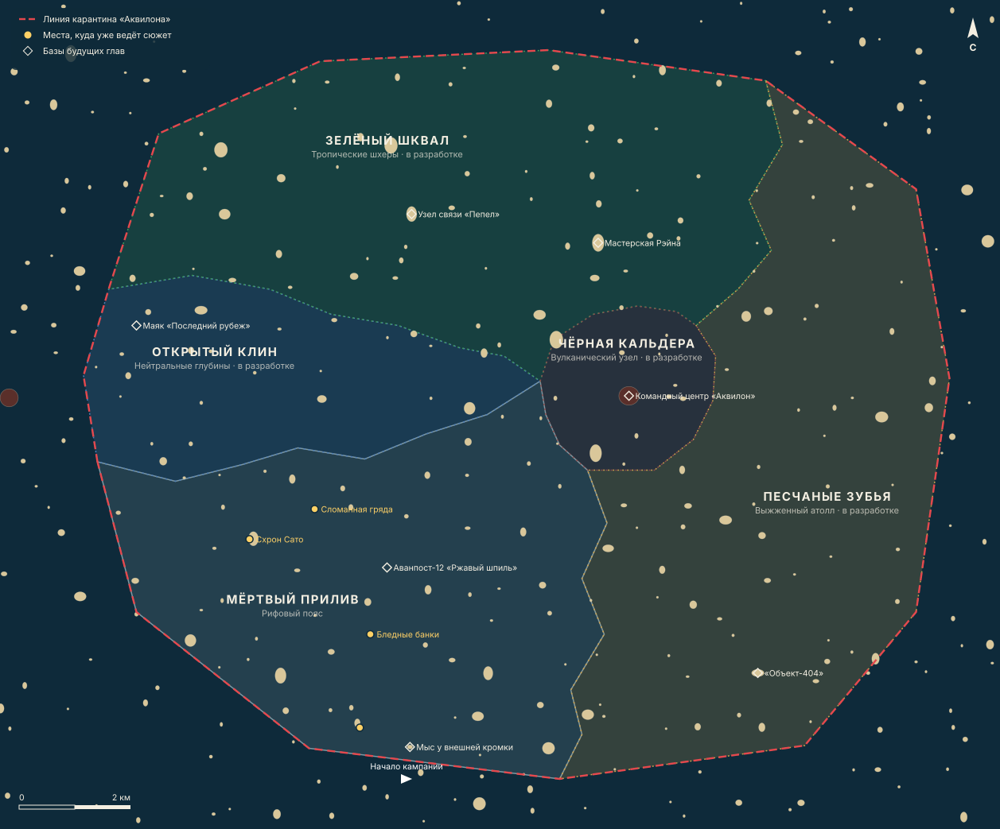

# Карта архипелага и сектора

> Основа — черновик «СЕКТОРА/ЗОНЫ». Изменена структура: сектора — соседние районы с неровными границами по проливам, как на настоящей карте, а не кольца вокруг кальдеры.

Карта генерируется из `src/simulator/story/content/geography.ts`: `npm run campaign:map`.

## Как устроена карта

- **Линия карантина** — ломаная из прямых участков: так объявляют настоящие запретные зоны, по координатам вершин. Зона около 15 × 13 км. Кампания начинается за линией, на западе.
- **Открытый клин** — язык глубокой воды, который входит в архипелаг с запада, между рифами и шхерами. Он упирается в единственный фарватер Чёрной кальдеры. Название сектора стало буквальным: это клин открытой воды.
- **Мёртвый прилив** — рифовый пояс вдоль юго-западной кромки. С океана сюда тянет холодом, отсюда туманы.
- **Зелёный шквал** — шхеры на севере, самые крупные острова.
- **Песчаные зубья** — атолл на юго-востоке, с подветренной стороны.
- **Чёрная кальдера** не стоит в центре колец. Это вулканический остров, к которому ведёт Клин. С трёх сторон её окружают шхеры, атолл и рифы. Это единственный сектор, не выходящий к океану: так задумано, это цитадель.

Каждая граница между двумя секторами записана в данных один раз и общая для обоих. Поэтому щелей и наложений нет, и это проверяет тест.

## Ограничение: острова пока одинаковые

Острова в игре генерируются по всему океану: тропические кайо, холмистые, скалистые, с пирсами и маяками. Сектора уже лежат поверх них:

- игра знает, в каком секторе яхта;
- при входе показывает название;
- туман и погода в каждом секторе свои;
- места сюжета привязаны к настоящим островам, пирсам и отмелям.

Но рельеф пока общий для всех. Свой ландшафт у каждого сектора — отдельный крупный этап, «географический проход» 📝:

- **Мёртвый прилив:** рифы под самой поверхностью, которые пробивают корпус; полосы прибоя; полузатопленные вышки.
- **Зелёный шквал:** мангровые заросли, узкие протоки, ветви над мачтой.
- **Песчаные зубья:** кольцевые атоллы, песчаные косы, без укрытий.
- **Открытый клин:** в нём не будет островов, только открытый океан.
- **Чёрная кальдера:** вулкан станет кальдерой с затопленным кратером и чёрными базальтовыми стенами. Сейчас на его месте действующий вулкан игры, см. [open-questions.md](open-questions.md), вопрос 7.

---

## 1. «Мёртвый прилив» — рифовый пояс 🟡

- **Ландшафт и навигация:**
  - мели, лабиринты острых коралловых рифов, постоянный туман;
  - идти можно только по старым створам и эхолоту;
  - столкновение с рифом пробивает корпус.
  - В игре сейчас ✅ густая дымка и пасмурная погода; рифы 📝.
- **Враги:**
  - мародёры на «Зодиаках» с ручными пулемётами и гранатомётами, берут числом и абордажем на мелководье — 📝;
  - лёгкие патрули «Аквилона» — дроны-перехватчики ✅.
- **База:** «Аванпост-12» («Ржавый шпиль») — полузатопленная буровая мародёров. Штурм по техническим лестницам, перехват лебёдочного крана. Статус 📝.
- **Союзник:** Холлоуэй, лагерь на пирсе ✅.
- **Апгрейд:** композитный киль и титановые накладки, −80 % урона от рифов. Статус 📝.
- **Экономика:**
  - лом, ржавое железо, литий-серные аккумуляторы с разбитых катеров;
  - сальваж дронов ✅.

## 2. «Зелёный шквал» — тропические шхеры 📝

- **Ландшафт и навигация:** мангровые заросли, узкие протоки, мачта цепляет ветви, приливные течения сносят на подводные скалы.
- **Враги:** авангард ЧВК «Эгида» в цифровом камуфляже, малые бронекатера с боевыми модулями, беспилотники-разведчики.
- **База:** узел связи «Пепел» — радиовышка на скале, минные заграждения на воде, турели на берегу.
- **Союзник:** Кендзи «Рэйн» Сато.
- **Апгрейд:** бесшумный гибридный электромотор.
- **Экономика:** медь, зашифрованные тактические планшеты, оптические матрицы.

## 3. «Песчаные зубья» — выжженный атолл 📝

- **Ландшафт и навигация:** открытые косы, сильный боковой ветер, солнце. Укрытий от шторма нет, солёная вода забивает охлаждение двигателя.
- **Враги:** тяжёлая пехота в экзоскелетах, полупогружные торпедные дроны-камикадзе по тепловому следу.
- **База:** «Объект-404» (Арсенал) — склад в толще скалы за гермоворотами. Открывается кодами из сектора или взрывчаткой.
- **Апгрейд:** водяное охлаждение замкнутого цикла и тепловые ловушки.
- **Экономика:** тугоплавкие металлы, чистые полупроводники, блоки наведения тяжёлых дронов.

## 4. «Чёрная кальдера» — вулканический узел 📝

- **Ландшафт и навигация:** глубоководный кратер с отвесными базальтовыми стенами, кипящая вода, водовороты, паровые завесы.
- **Враги:** отряд «Цербер» — бронированные катамараны с «гатлингами» и генераторами помех.
- **База:** командный центр «Аквилон» в затопленной приливной пещере. К нему ведёт единственный фарватер со стороны Клина, простреливаемый дальнобойными турелями.
- **Союзник:** Седов, бункер в кальдере.
- **Апгрейд:** ЭМИ-пушка и кевларово-карбоновые паруса.
- **Экономика:** чёрный рынок элитного оружия, корневые ключи, облигации Синдиката.

## 5. «Открытый клин» — нейтральные глубины 📝

- **Ландшафт и навигация:** открытое бурное море, огромные волны, штормовые фронты, никаких укрытий. Испытание корпуса и рангоута.
- **Враги:** автономные субмарины-охотники и тяжёлые патрульные суда на периметре карантина.
- **База:** маяк «Последний рубеж» — железобетонная башня у самой линии карантина, у дезертиров-инженеров.
- **Союзник:** Сара «Вектор» Дженкинс.
- **Апгрейд:** штормовой автопилот и носовой пневматический гарпун.
- **Экономика:** в черновике нет. Предложение — в [open-questions.md](open-questions.md), вопрос 8.
